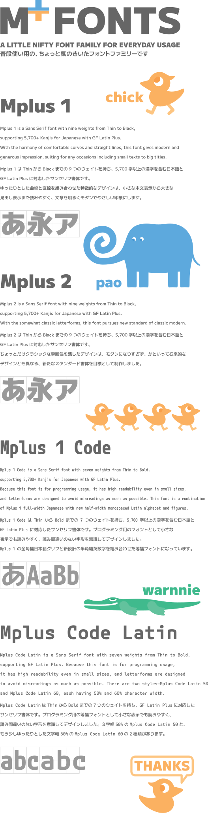

<p>
https://mplusfonts.github.io
</p>
<p>

# Building the M PLUS fonts

## Requirements
- Python **3.9 or newer** (3.12 recommended). The system Python of older macOS versions is too old.
- Everything else is installed into a local virtual environment (`venv/`) from `requirements.txt`.
  If the default `python3` is too old, create the environment by hand first:

  ```
  python3.12 -m venv venv
  venv/bin/pip install --upgrade pip
  venv/bin/pip install -r requirements.txt
  touch venv/touchfile
  ```

## Commands
Run these from the repository root.

| Command | What it does |
|---|---|
| `make build` | Builds **all** families into `fonts/` (cleans working directories first, takes a while) |
| `make build_MPLUS1` | Builds only M PLUS 1 |
| `make build_MPLUS2` | Builds only M PLUS 2 |
| `make build_MPLUS3` | Builds only M PLUS 3 (Japanese, with the shared Kanji) |
| `make build_MPLUSU` | Builds only M PLUS U |
| `make build_MPLUS1Code` | Builds only M PLUS 1 Code (width 500 + Kana + Kanji) |
| `make build_MPLUSCodeLatin` | Builds only M PLUS Code Latin (widths 500 and 600) |
| `make check_MPLUS3` | Prints how the Kanji will be merged into each MPLUS3 master (builds nothing; run `make prep_MPLUS3 prep_MPLUSKanji` first) |
| `make clean` | Deletes generated working directories (`masters`, `merged_ufo`, `instances`); `fonts/` is kept |

The single-family targets do not run `make clean`. If the `.glyphs` sources changed a lot, run `make clean` first.
Output goes to `fonts/<Family>/` (`otf/`, `ttf/`, `variable/`, `webfonts/`).

## How the build works
1. **prep** – `fontmake` converts each `.glyphs` source into UFO masters (`sources/<name>/masters`).
2. **instancer** – interpolates Thin / Regular / Bold instances of M PLUS 1 and of the Kanji (used only by the Code fonts).
3. **merge** – combines the pieces into `sources/<name>/merged_ufo`:
   - MPLUS1 / MPLUS2 / MPLUSU: `sources/scripts/merge.py` merges the shared Kanji (`sources/MPLUSKanji`) into each master with `ufomerge`, and installs `sources/scripts/features.fea`.
   - MPLUS3: `sources/scripts/merge_mplus3.py` does the same for MPLUS3 (see below).
   - MPLUS1Code: only the width-500 masters (file names without `60`) are used; Kana comes from MPLUS1 (`sources/MPLUS1Code/kana_glyphs.txt`), Kanji from the Kanji instances, features from `sources/scripts/code.fea`.
   - MPLUSCodeLatin: copy of all MPLUS1Code masters (widths 500 and 600), renamed to "M PLUS Code Latin".
4. **compile** – `gftools builder sources/<name>/config.yaml` builds the variable font, static TTF/OTF and webfonts.

## MPLUS3 notes
- Each MPLUS3 master gets the Kanji master of the same name and weight (Thin, Medium, Black).
  If a master has no counterpart, the Kanji is interpolated at that weight.
- If both fonts contain the same character under different glyph names (for example `close-han` in MPLUS3 and `uni3006` in the Kanji font), the **MPLUS3 glyph is kept** and the Kanji one is dropped.
- Quadratic (TrueType) curves cannot be processed by the overlap remover, so any are converted to cubic curves during the merge. Fixing them in the `.glyphs` source is better; the script prints the glyph names it had to convert.

## Troubleshooting
- `No matching distribution found for pygit2` / `Failed to build cryptography`: Python is too old or no pre-built packages exist for it. Use Python 3.12 (see Requirements).
- `zsh: no matches found: --include=*.glif`: quote wildcards, e.g. `--include='*.glif'`.
- Empty folders such as `fonts/MPLUS1 2`: harmless leftovers created by macOS; delete with `rmdir`.
- Rebuilding existing fonts with newer tools changes the GSUB / GPOS / GDEF / head tables internally while glyphs, metrics and names stay identical. Avoid committing rebuilt binaries unless the sources changed.
</p>