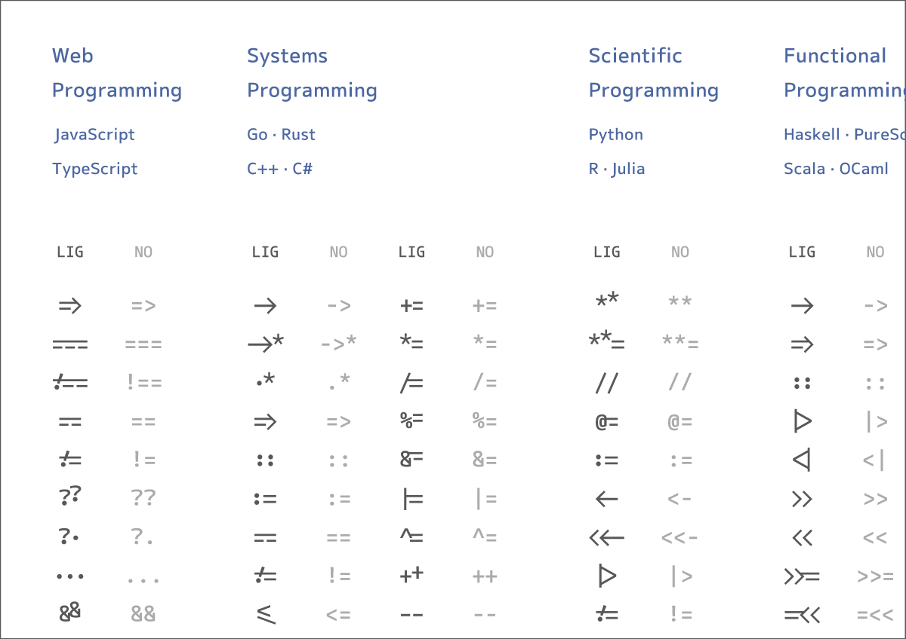
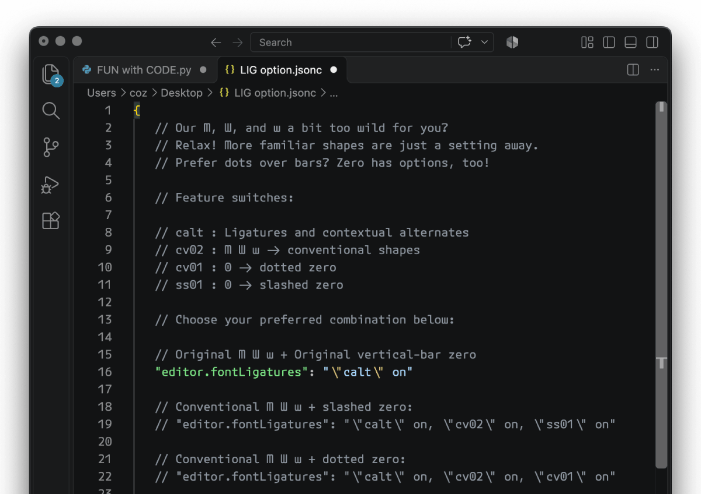

<!-- 1. Eye-catching video -->

  

<!-- 2. Ligature List - Category 1 -->

  

<!-- 3. Ligature List - Category 2 -->

<!-- 4. Code Sample -->

<!-- 5. Font Options -->

---

## About

**M PLUS Code LIG** is a monospaced programming font designed to make coding a little more fun.

With a wide range of programming ligatures and distinctive character designs, it brings a playful touch to your code while maintaining readability.

**Fun with Code.**

## Experimental Release

This is an experimental release of M PLUS Code LIG.

The font is still under development. Your feedback and suggestions are welcome and will help improve the final release.

## Font Files

The experimental release includes:

- **Variable Font** — Adjustable font weights
- **Regular 60** — Static regular weight
- **Bold 60** — Static bold weight

## Installation

1. Download the font files.
2. Install the font on your system.
3. Select **M PLUS Code LIG** in your code editor.
4. Enable font ligatures to enjoy the full experience.

## Ligature Settings

See the settings example below to enable ligatures and customize character styles.

[Download Settings Example](./MPLUS1CodeLIG-settings.jsonc)

## Complete Ligature List

[View the Complete Ligature List (SVG)](./MPLUS1CodeLIG-Ligature-List.svg)

## Feedback

Found a problem or have a suggestion?

Please share your feedback through [GitHub Issues](../../issues).

## License

See [LICENSE](./LICENSE) for license information.
