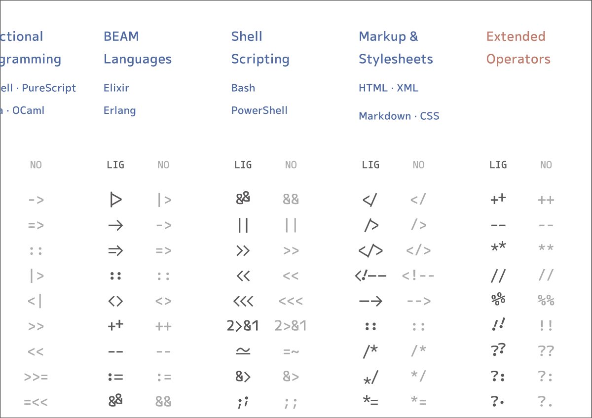
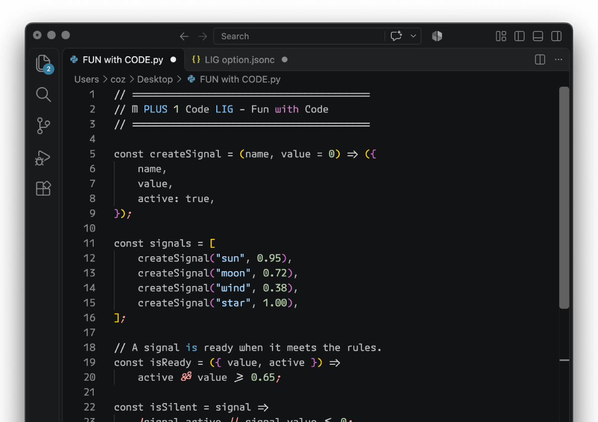

<!-- 1. Eye-catching video -->
<p align="center">
  
</p>

<p>&nbsp;</p>

<!-- 2. Ligature List - Category 1 -->
<p align="center" style="margin: 4em 0;">
<a href="https://raw.githubusercontent.com/coz-m/MPLUS_FONTS/master/sources/MPLUScodeLIG/images/original/ligature-list-01.svg"
   target="_blank"
   rel="noopener">
    
  </a>
</p>

<p>&nbsp;</p>

<!-- 3. Ligature List - Category 2 -->
<p align="center" style="margin: 4em 0;">
  <a href="https://raw.githubusercontent.com/coz-m/MPLUS_FONTS/master/sources/MPLUScodeLIG/images/original/ligature-list-02.svg"
     target="_blank"
     rel="noopener">
    
  </a>
</p>

<p>&nbsp;</p>

<!-- 4. Code Sample -->
<p align="center" style="margin: 4em 0;">
  <a href="https://raw.githubusercontent.com/coz-m/MPLUS_FONTS/master/sources/MPLUScodeLIG/images/original/LIG_sample.png"
     target="_blank"
     rel="noopener">
    
  </a>
</p>

<p>&nbsp;</p>

<!-- 5. Font Options -->
<p align="center" style="margin: 4em 0;">
  <a href="https://raw.githubusercontent.com/coz-m/MPLUS_FONTS/master/sources/MPLUScodeLIG/images/original/LIG_option.png"
     target="_blank"
     rel="noopener">
    
  </a>
</p>

<p>&nbsp;</p>

---

## About

**M PLUS Code LIG** is a monospaced programming font designed to make coding a little more fun.

With a wide range of programming ligatures and distinctive character designs, it brings a playful touch to your code while maintaining readability.

**Fun with Code.**

## Experimental Release

This is an experimental release of M PLUS Code LIG.

The font is still under development. Your feedback and suggestions are welcome and will help improve the final release.

## Font Files

The experimental release includes:

- **Variable Font** — Adjustable font weights and widths
- **Regular 60** — Static regular weight
- **SemiBold 60** — Static bold weight

## Installation

1. Download the font files.
2. Install the font on your system.
3. Select **M PLUS Code LIG** in your code editor.
4. Enable font ligatures to enjoy the full experience.

### Using with Visual Studio Code

1. Install **MPLUScodeLIG** on your system.
2. Restart Visual Studio Code if it is already running.
3. Open the Command Palette (`Ctrl+Shift+P` on Windows/Linux or `Cmd+Shift+P` on macOS).
4. Select **Preferences: Open User Settings (JSON)**.
5. Add or update the following settings:

```json
{
  "editor.fontFamily": "MPLUScodeLIG",
  "editor.fontLigatures": "\"calt\" on"
}
```

The `calt` feature enables contextual substitutions, including programming ligatures.

#### Font Options

You can customize the appearance of certain characters by enabling additional OpenType features. Choose one of the configurations below and replace the value of `editor.fontLigatures` in your settings:

- **Original M, W, w + Vertical-bar Zero**
  ```json
  "editor.fontLigatures": "\"calt\" on"
  ```

- **Conventional M, W, w + Slashed Zero**
  ```json
  "editor.fontLigatures": "\"calt\" on, \"cv02\" on, \"ss01\" on"
  ```

- **Conventional M, W, w + Dotted Zero**
  ```json
  "editor.fontLigatures": "\"calt\" on, \"cv02\" on, \"cv01\" on"
  ```

- **Original M, W, w + Dotted Zero**
  ```json
  "editor.fontLigatures": "\"calt\" on, \"cv01\" on"
  ```

For more details about these options, see [MPLUScodeLIG-settings.jsonc](MPLUSCodeLIG-settings.jsonc).

**Note:** Use only one of the configurations above at a time. You can switch between them whenever you like.

## Ligature Settings

See the settings example below to enable ligatures and customize character styles.

[View Settings Example](./MPLUSCodeLIG-settings.jsonc)

## Complete Ligature List


[View the Complete Ligature List 1 (SVG)](./images/original/ligature-list-01.svg)
[View the Complete Ligature List 2 (SVG)](./images/original/ligature-list-02.svg)

## Feedback

Found a bug or have an idea?
We'd love to hear your feedback!

[Report an Issue](https://github.com/coz-m/MPLUS_FONTS/issues)

## License

See [LICENSE](../../OFL.txt) for license information.
